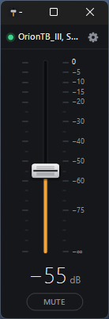

# Orion Volume

A small Windows app for controlling the main monitor volume and mute on an Antelope Orion audio interface over the network.

  

The window scales smoothly, from a narrow strip (right) up to a large fader. The gear button opens the server settings (left).

## Build

Download the files and run `build.bat`. It uses the C# compiler that comes with Windows (.NET Framework 4), so nothing needs to be installed. It produces `OrionVolume.exe`.

## Use

- On first run it finds the Orion on the network automatically. If that fails, click the gear and enter the server address and port.
- Drag the fader cap to set the level. Click the track above or below the cap to nudge 1 dB.
- Mouse wheel or Up/Down: 1 dB. Page Up/Page Down: 5 dB. M: mute. Esc: close settings.
- Drag the window from any empty area.

Settings are saved in `%APPDATA%\orion_volume.json`.

## Use at your own risk

This software is provided "as is". However, it's very simple, and the functionality is roughly the same as the master control knob in the original interface program, so the risk of glitches are low. It's possible this might also work on other Antelope devices.

This tool is meant only for controlling the volume of your own device. It is not intended to facilitate hacking or misuse of Antelope hardware or software, or anything else malicious.

## License

Do whatever you want with this.
